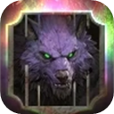
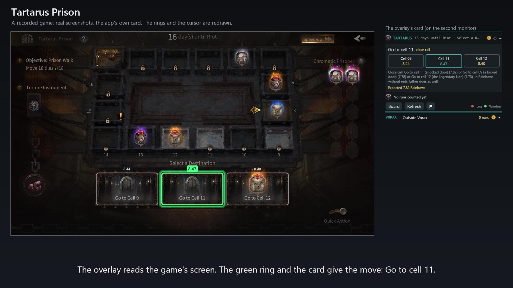

#  TLI Overlay Plus

One overlay for Torchlight: Infinite's league minigames, **Tartarus Prison** and **Vorax** (Surgical Preparation). It reads the game's screen and tells you the best move, on a small card and with green rings over the game.

It replaces Tartarus Advisor and Vorax Overlay Plus. Those move over to it by themselves.

**▶ [Watch the 40-second demo](https://github.com/Giboork/tli-overlay-plus/raw/main/media/tli-overlay-plus-demo.mp4)** (23 MB MP4)

## Download

1. Download `tli-overlay-plus.exe` from the [latest release](https://github.com/Giboork/tli-overlay-plus/releases/latest).
2. Run it. There's nothing to install and no source code to download.
3. It updates itself. It checks at start and every hour, and the card asks before installing.

Windows only.

## How it works

- It follows the game's log (`UE_game.log`) to know when a screen changes, then takes a picture of the game and reads it.
- Every possible move is played out to the end of the run thousands of times (2,000 by default in Tartarus). The card shows the move with the best odds and the expected result of each option.
- From your move to the next advice on screen, median: Tartarus 0.59 s, Vorax 1.0 s. Most of that is waiting for the game's screen to settle.
- It doesn't touch the game: no memory reading, no injected code, no clicks or key presses. It only looks at the screen and reads the log file the game writes anyway.

## It's bugging out: quick fixes

Most wrong advice comes from a wrong read of the screen. Try these in order:

1. **Move the card off the game.** Another monitor is best. The overlay reads pictures of the screen, so a card or ring sitting over the game ends up in the picture. When it's in the way, the card says "The card is over the game".
2. **Let it see the whole game.** Play fullscreen or borderless, with the whole window on one monitor and nothing over it (other overlays, a browser, a stream preview).
3. **Check the two dots at the card's foot.** Both should be green. For a red Log or Window dot, see the FAQ below.
4. **Press Refresh** once the screen has settled. It reads the game again and picks up from there.
5. **Vorax:** play at 1920x1080 or bigger (1280x720 reads poorly), and make sure Windows can read English text (see the FAQ).
6. **Restart the overlay.** Right-click the tray icon → Quit, then run it again.

## Nothing helped? Send me the game

Zip the game and send it to **giboork@gmail.com**:

1. Right-click the tray icon → Settings → the Tartarus or Vorax tab → Recorded games → **Open the folder**.
2. Each game is a numbered folder; the highest number is your last game. Right-click it → Compress to ZIP file (on Windows 10: Send to → Compressed (zipped) folder).
3. Email the zip with a line on what went wrong, at which day or round, and your version (Settings → General → Updates).

A game is about 30 MB zipped. Gmail turns a big attachment into a Drive link by itself. From other mail, upload it to Google Drive, OneDrive or WeTransfer and send the link.

Only the last 5 games are kept, so send it before you play many more. The folder holds pictures of the game, the game's log lines and what the overlay read. Nothing else from your PC.

## FAQ

**How do I close it?**
Right-click the tray icon (by the clock) → Quit.

**The card disappeared.**
Outside the minigames it moves off the game's screen, and it comes back when you enter Tartarus or Vorax. A card on another monitor stays put. Right-click the tray icon → Show the card brings it back any time.

**My fps drops or the game stutters with the overlay open.**
Any window over a fullscreen game can change how Windows draws the game (V-Sync, G-Sync/FreeSync, frame pacing). That's why the card steps aside outside the minigames. Keep it on another monitor if you can, and switch off the league you're not playing.

**The Log dot is red.**
The overlay can't find the game's log, so it only reads the screen when you press Refresh. Click the dot (or Settings → General → Game log) → Browse… and pick `UE_game.log`. It's usually in the game's folder under `UE_game\TorchLight\Saved\Logs\`. If the file is set and the dot stays red, the game isn't writing it: turn logging on in the game.

**The Log dot is gold.**
The overlay reads the game's log, but no Tartarus move shows in it, so it only reads the screen when you press Refresh. Turn on logging in the game's settings (the same option FE trackers need) and restart the game.

**The Window dot is red.**
The game's window isn't found. Is the game running?

**The advice doesn't change after my move.**
Check that the Log dot is green, then press Refresh.

**It's stuck on something that isn't on screen.**
For example "Doors are always among the 6 cells ahead of the warden", the wrong days until Riot, or "show the prison board". It misread the screen. Go through the quick fixes above and press Refresh. If it keeps happening, send me the game.

**Vorax doesn't read anything, or says English text recognition isn't installed.**
Vorax reads numbers with Windows' English text recognition, and any English works. If none is installed, add English (United States) under Settings → Time & language → Language & region → Add a language. Windows stays in your language. Then restart the overlay.

**Does it work on ultrawide or other resolutions?**
Yes, ultrawide included. Vorax reads best at 1920x1080 or bigger.

**Several moves are green.**
Those are near-ties. Settings → Tartarus → untick "Ring near-ties" to see only the best one.

**I followed it and got 2 rainbows.**
It plays the odds; it doesn't see the future. The card shows the expected result of each option, but a single run is still luck. Judge it over many runs.

**I only play one of the leagues.**
Settings → that league's tab → untick Enable. Nothing of it runs then.

**Does it update itself?**
Yes, at start and every hour, and it asks first. To check now: Settings → General → Updates → Check for updates. Old Tartarus Advisor and Vorax Overlay Plus builds move to TLI Overlay Plus by themselves.

**Linux or Steam Deck?**
No. It needs Windows' screen capture and text recognition.

**Can I get banned for this?**
It doesn't touch the game: no memory reading, no injected code, no clicks or key presses. It reads pictures of the screen and the log file the game writes. I haven't seen an official word from the developers either way, so use it at your own risk.

**Why isn't it open source?**
People took my earlier tools, added their own donate buttons and shipped them, so now only the exe is published. If you don't want to run it, don't.

**Is it free?**
Yes. The donate button helps it keep up with the game.
